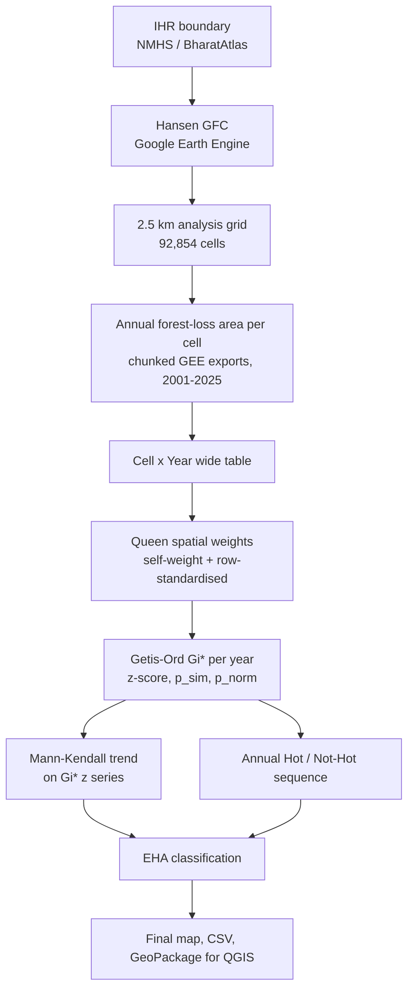

# Emerging Hot Spot Analysis of Forest Loss in the Indian Himalayan Region (2001–2025)

A reproducible, notebook-based pipeline that detects **where** and **when** forest-loss hot spots emerge, persist or fade across the Indian Himalayan Region (IHR). It combines Hansen Global Forest Change data, a 2.5 km analysis grid, the Getis-Ord **Gi\*** statistic, the **Mann-Kendall** trend test and a rule-based **Emerging Hot Spot Analysis (EHA)** classification.


---

## Highlights

| | |
|---|---|
| **Study area** | Indian Himalayan Region (NMHS boundary) |
| **Period** | 2001–2025 (25 annual layers) |
| **Source data** | Hansen GFC `UMD/hansen/global_forest_change_2025_v1_13` (30 m) via Google Earth Engine |
| **Baseline forest** | Tree cover in 2000 ≥ 10 % canopy (FSI definition), valid-data mask applied |
| **Spatial unit** | 92,854 regular 2.5 km cells (custom equal-area projection) |
| **Space-time observations** | 2,321,350 (92,854 cells × 25 years) |
| **Hot spot statistic** | Getis-Ord Gi\*, Queen contiguity, 999 permutations |
| **Trend test** | Mann-Kendall on each cell's 25-year Gi\* z-score series |
| **Output** | 8 EHA categories + "No Pattern Detected", CSV and GeoPackage for QGIS |

> **Scope:** Phase I of the study describes *where and when* loss clusters occur. It does not attempt to explain *why* (drivers); that is reserved for a future extension.
> **Note:** Hansen "loss" is stand-replacement disturbance, not necessarily permanent deforestation.

---

## Workflow



---

## Repository structure

```
.
├── data/
│   ├── raw/            # boundary, grids, annual loss CSVs, Cell x Year table, baseline forest
│   └── processed/      # cached spatial weights (.gal), exported loss maps
├── notebooks/          # the six notebooks below (run in order)
├── outputs/
│   ├── gi_star_annual/        # one Gi* CSV per year
│   ├── giz_yearly_images/     # Gi* z-score maps, 2001-2025
│   ├── gi_hotspots_yearly/    # significant hot spot maps, 2001-2025
│   ├── mann_kendall/          # autocorrelation + Mann-Kendall results
│   ├── eha_classification/    # full EHA attribute table
│   ├── final_map/             # final EHA map
│   └── qgis/                  # GeoPackage for cartography in QGIS
├── docs/images/        # figures used in this README
├── src/
├── LICENSE
└── README.md
```

---

## Notebooks (run in this order)

| # | Notebook | What it does |
|---|---|---|
| 1 | `Notebook1.ipynb` | Loads the IHR boundary and Hansen GFC in Earth Engine; builds the 2.5 / 5 / 10 km grids; computes annual forest loss and baseline (2000) forest area per cell via year-by-year chunked GEE exports; assembles the Cell × Year table |
| 2 | `forest_loss_export.ipynb` | Visual QA of absolute forest loss; computes **relative loss (% of baseline forest)** and exports yearly maps |
| 3 | `GettisOrdTest.ipynb` | Small-block sandbox used to validate the Gi\* workflow before the full run |
| 4 | `GettisOrd.ipynb` | Full Queen-weights build and Gi\* for all cells and years; yearly z-score and significant-hot-spot maps |
| 5 | `mann_kendall.ipynb` | Lag-1 autocorrelation diagnostic and Mann-Kendall trend test per cell |
| 6 | `EHA_Classification.ipynb` | Combines hot spot history with trend results into EHA categories; final map; QGIS export |

---

## Methodology

### 1. Baseline forest and spatial unit
Forest is defined as Hansen `treecover2000 ≥ 10 %` (consistent with the Forest Survey of India canopy definition), masked with the Hansen `datamask`. A regular square grid is generated in a custom **Lambert Azimuthal Equal-Area** projection centred on the IHR, so cell sizes stay accurate across the whole Himalayan arc, then reprojected to WGS84. Only cells intersecting the boundary are kept, each with a unique `Cell_ID`. The 2.5 km scale is primary; 5 km and 10 km grids are generated for later sensitivity testing.

### 2. Annual forest-loss observations
For each year, pixels with `lossyear == year − 2000` **inside the baseline forest mask** are converted to hectares (`ee.Image.pixelArea()`) and summed per cell at the native 30 m scale. To stay inside Earth Engine request limits, the grid is processed in chunks (3,000 cells, `tileScale=8`) one year at a time, exported to Drive as CSV, and merged locally. Baseline (2000) forest area per cell is exported the same way and used for relative-loss maps.

### 3. Spatial weights (Queen contiguity)
Queen contiguity weights are built once and cached to disk (`data/processed/ihr_queen_weights.gal`). For a true Gi\* (not Gi), each cell is included in its own neighbourhood by explicitly filling the diagonal (`fill_diagonal(w, 1.0)`) before row-standardisation, rather than letting the library infer a self-weight.

### 4. Getis-Ord Gi\*
Gi\* is computed independently for every year with `esda.G_Local` (999 conditional permutations), returning the z-score, simulated p-value (`Gi_star_p_sim`) and analytical p-value (`Gi_star_p_norm`). Each year is written to its own CSV and the loop skips completed years, so it can be stopped and resumed.

A cell-year is classified as a **hot spot** only when z-score and p-value agree:

| Class | Condition |
|---|---|
| Hot Spot 99 % | z > 2.58 and p ≤ 0.01 |
| Hot Spot 95 % | z > 1.96 and p ≤ 0.05 |
| Hot Spot 90 % | z > 1.65 and p ≤ 0.10 *(shown on yearly QA maps only)* |

For the EHA step, "hot" means **95 % or 99 %** significance. With 999 permutations the smallest resolvable `p_sim` is 0.001.

### 5. Mann-Kendall trend
Each cell's 25-year Gi\* z-score sequence is tested with `pymannkendall.original_test`, storing trend direction, significance flag, p-value, z, Kendall's τ, S, Var(S) and Sen's slope. A lag-1 autocorrelation diagnostic (`|r| > 2/√n`) is computed and saved alongside (`ihr_lag1_autocorrelation.csv`) so autocorrelated cells can be identified or re-tested with a modified Mann-Kendall variant. Series with zero variance (constant Gi\*) are checked and flagged in the notebook.

### 6. EHA classification
Per-cell metrics are computed with vectorised NumPy: total hot years, hot-year frequency, whether the final year is hot, and the length of the trailing consecutive hot run. Cold spots (z < −1.96, p ≤ 0.05) are used only to separate *oscillating* from *sporadic* behaviour.

| Category | Rule (summary) |
|---|---|
| **New** | Final year hot; hot in exactly one year |
| **Consecutive** | Uninterrupted final run of ≥ 2 hot years, never hot before, < 90 % hot overall |
| **Intensifying** | ≥ 90 % hot, final year hot, significant **increasing** trend |
| **Persistent** | ≥ 90 % hot, final year hot, no significant trend |
| **Diminishing** | ≥ 90 % hot, final year hot, significant **decreasing** trend |
| **Historical** | ≥ 90 % hot, final year **not** hot |
| **Oscillating** | Final year hot, prior cold-spot history, < 90 % hot |
| **Sporadic** | < 90 % hot, hot at some point, never a cold spot |
| **No Pattern Detected** | Everything else |

---

## Results

| EHA category | Cells | Share |
|---|---:|---:|
| No Pattern Detected | 81,300 | 87.6 % |
| Sporadic Hot Spot | 10,998 | 11.8 % |
| Consecutive Hot Spot | 308 | 0.3 % |
| New Hot Spot | 248 | 0.3 % |
| Intensifying / Persistent / Diminishing / Historical / Oscillating | 0 | 0 % |

- **~12.4 % of cells** (11,554 of 92,854) were a significant hot spot in at least one year.
- The maximum hot-year frequency for any cell is **20 of 25 years (80 %)**, so no cell meets the ≥ 90 % threshold required for Intensifying, Persistent, Diminishing or Historical. Loss clustering in the IHR is spatially intermittent rather than continuously entrenched at the 2.5 km scale.
- The cell with the highest mean Gi\* z-score across all years is `G25_061108` (mean z ≈ 6.96).

### Figures

| Gi\* z-score (2025) | Significant hot spots (2017) |
|:---:|:---:|
|  |  |

| Forest loss, absolute (ha) | Forest loss, relative to 2000 baseline (%) |
|:---:|:---:|
|  |  |

Yearly maps for every year are generated by the notebooks (see `outputs/`).

---

## Outputs for QGIS

`EHA_Classification.ipynb` exports a ready-to-style layer:

- `outputs/eha_classification/ihr_eha_classification.csv` – full attribute table (join to the grid on `Cell_ID`)
- `outputs/qgis/ihr_eha_classification.gpkg` – grid geometry with `EHA_Category`, `Total_Hot_Years`, `Hotspot_Frequency`, `Final_Year_Hot`, `MK_trend`, `MK_p`, `MK_tau`, `MK_slope`

---

## Getting started

### Requirements
Python 3.12 with:

```
earthengine-api  geemap  geopandas  pandas  numpy  shapely  pyproj
libpysal  esda  pymannkendall  matplotlib
```

```bash
pip install earthengine-api geemap geopandas pandas numpy shapely pyproj libpysal esda pymannkendall matplotlib
```

### Earth Engine setup
`Notebook1.ipynb` initialises Earth Engine with a Google Cloud project ID. Replace `PROJECT_ID` with your own Earth Engine-enabled project and authenticate once:

```python
import ee
ee.Authenticate()
ee.Initialize(project="your-gcp-project-id")
```

### Running
1. Place the dissolved IHR boundary at `data/raw/ihr_boundary_dissolved.gpkg`.
2. Run the notebooks in the order above. Earth Engine exports are asynchronous: start them, wait for completion in the Tasks tab, then download the CSVs from Drive into `data/raw/` before running the merge cells.
3. All notebooks resolve paths relative to the project root, so they run from either the root or `notebooks/`.

Large intermediate files (grids, CSVs, cached weights) may be excluded by `.gitignore`; regenerate them by running the notebooks in order.

---

## Limitations and next steps

- **Forest loss ≠ deforestation.** Hansen loss captures canopy-removing disturbance, including fire, harvest and landslides.
- **Single spatial scale.** Results are for the 2.5 km grid with Queen contiguity; the 5 km / 10 km grids and distance-based weights are prepared for the **sensitivity analysis** (grid size, neighbourhood, forest threshold, end year), which is still to be run.
- **Mann-Kendall variant.** Ordinary Mann-Kendall is applied to all cells; autocorrelation is diagnosed but not yet used to switch to a modified test.
- **Province-level summaries** using the nine NMHS biogeographic provinces are planned.
- **Phase II (drivers).** Linking hot spot categories to terrain, climate, accessibility and land-use variables.

---

## Data sources and references

- Hansen, M. C., et al. (2013). High-resolution global maps of 21st-century forest cover change. *Science*, 342, 850–853.
- Harris, N. L., et al. – Emerging Hot Spot Analysis framework for forest-loss space-time patterns (2.5 km bins).
- Singh & Yan – Hot spot analysis of forest loss using a 10 km neighbourhood.
- Forest Survey of India – canopy density classification (>10 % threshold).
- National Mission on Himalayan Studies (NMHS) – IHR boundary, via BharatAtlas.

---

## Author

**Safal Krishna** · [@safal270803](https://github.com/safal270803)

## License

See [`LICENSE`](LICENSE).
